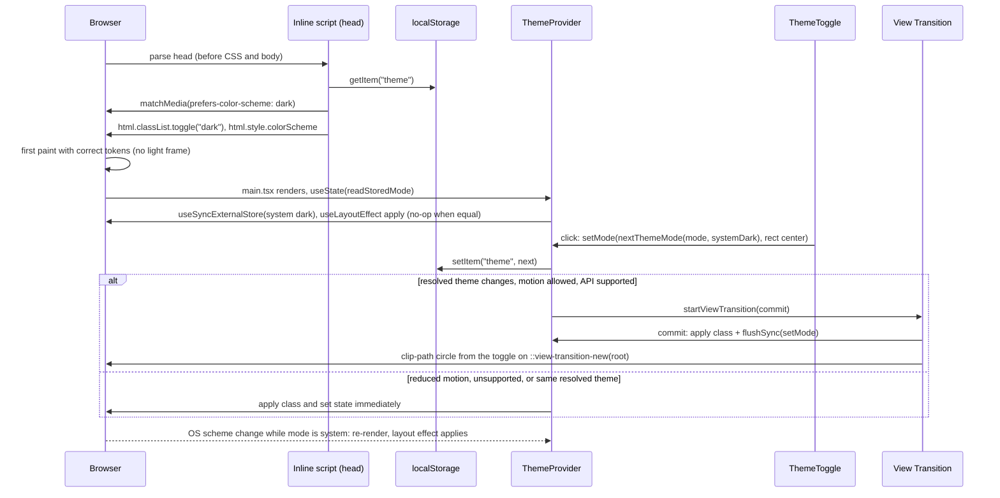
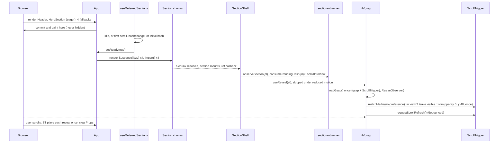

# Design: Portfolio Redesign

## Technical Approach

The change is delivered as the 19 commit-sized work units from the proposal. Each unit leaves `pnpm check` and `pnpm build` green. The architecture is a layered, feature-first SPA:

- **Five import tiers**, enforced by core ESLint `no-restricted-imports` `regex` patterns: leaf → infrastructure → components → features → app. There is a single `@/` alias.
- **Cross-cutting services** (`theme`, `i18n`, `config`) are a shared infrastructure tier, so shared components (the toggles, the sonner wrapper, the header) never import the app shell.
- **Browser state** (scroll, media queries, OS theme, active section) is read with `useSyncExternalStore` or ref callbacks with React 19 cleanup. No `setState` runs synchronously inside an effect, which keeps `eslint-plugin-react-hooks` v7 `recommended` green by construction.
- **Motion**: CSS for the hero text, marquee, shine and theme transition. GSAP stays lazy, is attached per section after mount, plays once, animates opacity only, and never hides content that is already in view.
- **Below-the-hero sections mount at idle**, or earlier on a hash, scroll or hashchange event, so the hero paints before section chunks are requested. The mobile sheet loads on first activation only.

The specs under `openspec/changes/portfolio-redesign/specs/` (page-shell, theming, localization, motion, portfolio-sections, contact-form, performance-budget, codebase-conventions) were read. This design is reconciled with them. Where they constrain a choice (single theme toggle whose name changes, primary CTA to Contact, sheet not loaded before first use, idle section prefetch), the spec wins and the decision table cites it.

## Architecture Decisions

| # | Decision | Choice | Rejected alternatives | Rationale |
|---|---|---|---|---|
| D1 | Layering | 5 tiers: `lib,types` → `config,i18n,theme,hooks` → `components/*` → `features/*` → `app`, `main.tsx` | Atomic-only tree; folder convention without lint | Feature cohesion with a small shared kit; tiers make "who may import whom" mechanical |
| D2 | Boundary enforcement | Core `no-restricted-imports` with `regex` patterns, one override per tier and per feature | `eslint-plugin-boundaries` or `eslint-plugin-import` (extra deps, ESLint 9 peer cap); gitignore-style negated `group` patterns | `regex` is in the installed ESLint 9.39 rule schema; zero dependencies; a negative lookahead expresses "not my own feature" exactly |
| D3 | Alias | Only `@/*`. `baseUrl` and `paths` stay in `tsconfig.json` (shadcn CLI reads it) and `tsconfig.app.json`; removed from `tsconfig.node.json`. `allowImportingTsExtensions` removed | Keep PascalCase aliases; drop root `paths` | Matches `components.json`; with no extensions allowed, `tsc` rejects `.tsx` import suffixes |
| D4 | Export style | Named exports everywhere, except modules loaded with `React.lazy` (`*Section.tsx`, `MobileMenu.tsx`), which use a default export | All default exports; `lazy(() => import(...).then(m => ({ default: m.X })))` | One readable rule; no wrapper noise at the lazy boundaries |
| D5 | Where theme, i18n and config live | Top-level `src/theme`, `src/i18n`, `src/config` (infrastructure tier) | `app/theme`, `app/config` (exploration tree) | `ThemeToggle`, `ui/sonner.tsx`, `Header` and `SocialLinks` are shared and must not import `@/app` |
| D6 | Browser subscriptions | `useSyncExternalStore` for scroll, media queries and active section; ref callbacks with cleanup for DOM observers | `useState` + `useEffect` listeners | Satisfies react-hooks v7 `set-state-in-effect`; no tearing; no leaks (fixes the leaked listener in `GoToTop.tsx:8-12`) |
| D7 | Theme control | One `ThemeToggle` button cycling `system → opposite(OS) → OS → system`. Its accessible name contains the current mode | shadcn ToggleGroup (the spec requires a name that updates after activation); a fixed `light → dark → system` cycle (first click can be a visual no-op) | Theming spec "Screen reader name"; the first click always flips visibly; zero new UI deps |
| D8 | Theme-change animation | View Transitions API circular reveal from the toggle center. Skipped under reduced motion or when the API is unsupported | Keep `.dark .animate-clip-expand` on the app root | The old clip runs only light → dark, replays on every load for dark users (more visibly once the pre-paint script and splash removal land) and is bound to an app wrapper. View Transitions animate both directions, only on user action |
| D9 | Theme storage | Key `theme` with `light`, `dark` or `system`; missing or invalid means system | New key | Returning visitors keep their stored `light`/`dark` value |
| D10 | Hero background swap | CSS `background-image` from two custom properties set by the hero feature, switched with the `dark:` variant | `useDocumentDark` (MutationObserver) + ``; two `` toggled with `display` | Only the matching image is fetched; no JS; the asset stays inside the feature |
| D11 | i18n typing | EN `as const` + `CustomTypeOptions`; ES `satisfies Messages` (EN deep-widened to `string`) | JSON resources; typing keys only | Missing, extra or unknown keys fail `tsc` (localization spec) |
| D12 | Locale | `useLocale()` returns `toLocale(i18n.resolvedLanguage)`; `supportedLngs`, `nonExplicitSupportedLngs`, `load: "languageOnly"` | Scattered `=== "es"` or `startsWith("es")` | One resolution point; `es-MX` resolves to `es` |
| D13 | Dates | ISO `YYYY-MM`, `Intl.DateTimeFormat` in UTC, i18next plural keys, `now` captured at module scope | String concatenation (`DateFormatter.ts`); `Intl.DurationFormat` | Locale-correct month names; deterministic; avoids the react-hooks `purity` rule; DurationFormat types are not in TS 5.7 lib |
| D14 | Tech and brand icons | Path data (`IconDef`) rendered by one `SvgIcon` atom with `fill="currentColor"`; inner details become mask knockouts | Component map (JSX in data, ~20 components); raw SVG strings + `dangerouslySetInnerHTML`; SVGR plugin | Data stays `.ts`; one renderer owns color, size and a11y; no build dependency |
| D15 | SplitText | CSS keyframes driven by custom properties, per-letter `--i` stagger, IntersectionObserver through a callback ref, `sr-only` text + `aria-hidden` letters | `@react-spring/web` 10 | Removes a dependency from the eager path; ARIA 1.2 forbids `aria-label` on `p` and generic elements |
| D16 | Scroll reveal | `useReveal` ref callback in `SectionShell`: `gsap.matchMedia`, `once`, opacity and `y` only, skipped when already in view, `clearProps`, ResizeObserver-driven `ScrollTrigger.refresh` | App-level `useScrollAnimation`; replace GSAP with IntersectionObserver + CSS | GSAP kept (fixed decision); never flashes the hero or in-view content; offsets stay correct after lazy mounts |
| D17 | Mobile menu | Eager trigger button. The Sheet module is `React.lazy` and loads on first activation | Eager Sheet; idle or hover prefetch | Performance spec: "sheet code MUST NOT load before the menu is first used" |
| D18 | Section loading | Lazy sections mount after first paint at idle, or earlier on initial hash, `hashchange` or first scroll | Render the lazy sections immediately (React fetches every chunk during the first render) | Performance spec: the hero renders before section chunks are fetched, and the chunks then arrive without user scrolling |
| D19 | Vendor `manualChunks` | None | Split react and i18n into vendor chunks | Low repeat-visit value; misconfiguration can pull lazy-only deps into the eager path; Vite 8 (deferred) changes the chunking API |
| D20 | Build target | Vite default browser baseline (remove `build.target: "esnext"`) | Keep `esnext` | `esnext` syntax can brick older Safari/iOS; the theme script is ES5 anyway |
| D21 | Form validation | RHF native rules that return error codes, translated at render time | zod; translated strings stored in rules | A language switch re-translates visible errors; no 13 KB gz schema library |
| D22 | Contact transport | `fetch` + `AbortController` (10 s), discriminated result | axios; `AbortSignal.timeout`/`any` | Removes ~13 KB gz; distinguishes timeout from network failure; broad support |
| D23 | Email HTML | Structured label/value HTML; every label and value escaped; user values never pass through `t()` | Prose template interpolated by `t()` (`escapeValue: false`) | Escaping is explicit and testable; no interpolation bypass |
| D24 | Toaster placement | Sibling of the contact `<section>` inside the lazy Contact chunk | App root; inside the section | Sonner renders its own `<section>` (no nested sections); keeps sonner out of the main chunk |
| D25 | Project card link | Stretched-link pattern: one `<a>` on the project name covers the card | Wrap the whole card in `<a>` | The link name is the project name, not the whole card text; the image keeps meaningful alt text outside the link |
| D26 | Section ids | `hero`, `experience`, `techs`, `projects`, `contact` | `section-*` | Short, matching the nav; old `#section-*` deep links stop working (accepted) |
| D27 | StrictMode | Enabled in `main.tsx` | Off | Double-invoked ref callbacks and effects expose leaks such as the old scroll listener |

## 1. Structure and Boundaries

### 1.1 Final tree

```
index.html                      pre-paint theme script, meta/OG, favicon, no body classes
public/  favicon.ico  cv/Alexis_Matamoros_CV_EN.pdf  cv/Alexis_Matamoros_CV_ES.pdf
.env.example  .nvmrc  .github/workflows/ci.yml
src/
  main.tsx                      StrictMode + AppProviders + App
  index.css                     tokens, @theme, typography @utility, components layer, motion policy
  vite-env.d.ts                 ImportMetaEnv typing
  app/        App.tsx  AppProviders.tsx  useDeferredSections.ts
  config/     site.ts  env.ts
  theme/      ThemeProvider.tsx  theme-context.ts  useTheme.ts  theme.ts  theme-transition.ts
  i18n/       init.ts  i18next.d.ts  locales/en.ts  locales/es.ts
  types/      localized.ts  icon.ts
  lib/        utils.ts dates.ts localize.ts escape-html.ts mailto.ts gsap.ts
              section-observer.ts scroll.ts idle.ts merge-refs.ts
  hooks/      useScrolled.ts useMediaQuery.ts useReducedMotion.ts useActiveSection.ts
              useLocale.ts useInView.ts useReveal.ts
  components/
    ui/          badge button card input label sheet textarea sonner   (shadcn only)
    animations/  SplitText.tsx  ShinyText.tsx
    atoms/       SvgIcon.tsx  BrandIcon.tsx  ExternalLink.tsx  Logo.tsx
    molecules/   SectionHeader.tsx  ThemeToggle.tsx  LanguageToggle.tsx  NavLinks.tsx  SocialLinks.tsx
    layout/      Header.tsx  MobileMenu.tsx  Footer.tsx  SideRails.tsx  ScrollToTop.tsx
                 SectionShell.tsx  SkipLink.tsx  Container.tsx
  features/
    hero/        HeroSection.tsx  components/HeroBackground.tsx  assets/hero-pattern-{light,dark}.webp
    experience/  ExperienceSection.tsx  components/{Timeline,TimelineItem}.tsx
                 data/experience.ts  experience.types.ts
    techs/       TechsSection.tsx  components/TechMarquee.tsx  data/techs.ts  techs.types.ts
    projects/    ProjectsSection.tsx  components/{ProjectGrid,ProjectCard}.tsx
                 data/projects.ts  projects.types.ts  assets/*.webp
    contact/     ContactSection.tsx  ContactFormPanel.tsx  components/{ContactForm,ContactDetails,ContactFallback}.tsx
                 hooks/useContactForm.ts  services/{contact.service,build-message-html}.ts
                 contact.schema.ts  contact.types.ts
```

Rules:

- **Containers and presentational components.** Files at a feature root are containers. They read data, call `useTranslation`/`useLocale` and build view models. Files under `features/*/components/` are presentational: they take props only, may hold UI-local state (for example "paused" or "visible count"), and import no data, services or i18n.
- **Shared kit.** Atoms and molecules may call `useTranslation` only for generic chrome strings (a11y hints) and may read the theme and i18n contexts. They never import feature data.
- **Promotion.** Code moves to the shared kit only when two or more features use it.
- **`ui/`** contains shadcn primitives only, added with `pnpm dlx shadcn@latest add <name>`.

### 1.2 Import matrix (lint-enforced)

| Tier | Paths | May import (`@/…`) | Blocked by lint |
|---|---|---|---|
| T0 leaf | `src/lib/**`, `src/types/**` | `lib`, `types` | anything else under `@/` |
| T1 infra | `src/config/**`, `src/i18n/**`, `src/theme/**`, `src/hooks/**` | T0, T1 | `@/components`, `@/features`, `@/app` |
| T2 components | `src/components/**` | T0, T1, T2 | `@/features`, `@/app` |
| T3 feature | `src/features/<f>/**` | T0, T1, T2, own feature | `@/app`, `@/features/<other>` |
| T4 app | `src/main.tsx`, `src/app/**` | everything | relative imports only |

Direction inside T2 (for example atoms must not import layout) is enforced by review, not lint. That keeps the config small. The rule also does not inspect dynamic `import()`, which is only used in T4 and `layout/Header.tsx` (same tier).

### 1.3 ESLint boundary configuration

Flat-config rule options are replaced, not merged, so every override restates the relative-import ban through `restrict()`. Order: base `src/**` first, then tiers, then features; the last match wins.

```js
const FEATURES = ["hero", "experience", "techs", "projects", "contact"];
const NO_RELATIVE = { group: ["./*", "../*"], message: "Use the @/ alias instead of relative imports." };
const NO_APP = { regex: "^@/app(?:/|$)", message: "Only src/main.tsx may import src/app." };
const NO_FEATURES_OR_APP = { regex: "^@/(?:features|app)(?:/|$)", message: "Shared code must not depend on features or the app shell." };
const NO_UI_TIERS = { regex: "^@/(?:components|features|app)(?:/|$)", message: "config, i18n, theme and hooks must not import components, features or app." };
const LEAF_ONLY = { regex: "^@/(?!(?:lib|types)(?:/|$))", message: "src/lib and src/types may only import src/lib and src/types." };
const featureOnly = (name) => ({
  regex: `^@/(?:app(?:/|$)|features/(?!${name}(?:/|$)))`,
  message: `src/features/${name} must not import the app shell or sibling features; promote shared code instead.`,
});
const restrict = (...patterns) => ["error", { patterns: [NO_RELATIVE, ...patterns] }];

// inside defineConfig([...]):
{ files: ["src/**/*.{ts,tsx}"], rules: { "no-restricted-imports": restrict(NO_APP) } },
{ files: ["src/main.tsx", "src/app/**/*.{ts,tsx}"], rules: { "no-restricted-imports": restrict() } },
{ files: ["src/components/**/*.{ts,tsx}"], rules: { "no-restricted-imports": restrict(NO_FEATURES_OR_APP) } },
{ files: ["src/{config,i18n,theme,hooks}/**/*.{ts,tsx}"], rules: { "no-restricted-imports": restrict(NO_UI_TIERS) } },
{ files: ["src/{lib,types}/**/*.ts"], rules: { "no-restricted-imports": restrict(LEAF_ONLY) } },
...FEATURES.map((name) => ({
  files: [`src/features/${name}/**/*.{ts,tsx}`],
  rules: { "no-restricted-imports": restrict(featureOnly(name)) },
})),
```

Probe (codebase-conventions "Boundary violation"): temporarily add `import "@/features/hero/HeroSection";` to `src/hooks/useScrolled.ts`, then `import "@/features/projects/data/projects";` to `src/features/experience/ExperienceSection.tsx`. `pnpm lint` must fail each time. Revert both.

### 1.4 Alias collapse

```ts
// vite.config.ts
import { fileURLToPath, URL } from "node:url";
resolve: { alias: { "@": fileURLToPath(new URL("./src", import.meta.url)) } },
// build.target removed (D20); the rest is unchanged
```

| File | Change |
|---|---|
| `tsconfig.app.json` | `paths: { "@/*": ["./src/*"] }`, keep `baseUrl: "./"`, remove the 9 other aliases and `allowImportingTsExtensions` |
| `tsconfig.json` | `compilerOptions: { baseUrl: ".", paths: { "@/*": ["./src/*"] } }` only (read by the shadcn CLI) |
| `tsconfig.node.json` | remove `baseUrl` and `paths` (`vite.config.ts` imports no local modules) |
| `components.json` | unchanged (already `@/…`) |

### 1.5 Move map (unit 6, move-only)

The input is the tree after units 1–5. The unit runs `git mv`, rewrites imports to `@/…`, and renames JSX-free hooks from `.tsx` to `.ts`. There are no logic edits. Default exports are kept; each file switches to the D4 export style when its own unit rebuilds it.

| Old path | New path |
|---|---|
| `src/App.tsx` | `src/app/App.tsx` |
| `src/components/Hero.tsx` | `src/features/hero/HeroSection.tsx` |
| `src/components/Timeline.tsx` | `src/features/experience/ExperienceSection.tsx` |
| `src/components/Techs.tsx` | `src/features/techs/TechsSection.tsx` |
| `src/components/Projects.tsx` | `src/features/projects/ProjectsSection.tsx` |
| `src/components/Contact.tsx` | `src/features/contact/ContactSection.tsx` |
| `src/hooks/useContactForm.tsx` | `src/features/contact/hooks/useContactForm.ts` |
| `src/constants/experience.ts` | `src/features/experience/data/experience.ts` |
| `src/constants/projects.ts` | `src/features/projects/data/projects.ts` |
| `src/constants/site.ts` (created in unit 3) | `src/config/site.ts` |
| `src/constants/theme.ts` | `src/theme/theme-options.ts` (deleted in unit 7) |
| `src/assets/img/hero-pattern-light.webp`, `-dark.webp` (unit 3) | `src/features/hero/assets/` |
| `src/assets/img/portfolio/*.webp` (20 files, unit 3) | `src/features/projects/assets/` |
| `src/components/common/Header.tsx` | `src/components/layout/Header.tsx` |
| `src/components/common/Footer.tsx` | `src/components/layout/Footer.tsx` |
| `src/components/common/ContactOptions.tsx` | `src/components/layout/SocialRail.tsx` (merged into `SideRails.tsx` in unit 11) |
| `src/components/common/EmailOptions.tsx` | `src/components/layout/EmailRail.tsx` (merged into `SideRails.tsx` in unit 11) |
| `src/components/ui/GoToTop.tsx` | `src/components/layout/ScrollToTop.tsx` |
| `src/components/ui/HeaderSeparator.tsx` | `src/components/atoms/HeaderSeparator.tsx` (deleted when the last user migrates, unit 16) |
| `src/components/ui/LangToogle.tsx` | `src/components/molecules/LanguageToggle.tsx` |
| `src/components/ui/ThemeToogle.tsx` | `src/components/molecules/ThemeToggle.tsx` |
| `src/hooks/useScrollAnimation.tsx` | `src/hooks/useScrollAnimation.ts` (deleted in unit 17) |
| `src/hooks/useDocumentDark.ts` | unchanged (deleted in unit 12) |
| `src/i18n/EN.ts`, `src/i18n/ES.ts` | `src/i18n/locales/en.ts`, `src/i18n/locales/es.ts` |
| `src/utils/DateFormatter.ts` | `src/lib/dates.ts` (rewritten in unit 13) |
| `src/utils/scroll.ts` | `src/lib/scroll.ts` |
| `src/main.tsx`, `src/index.css`, `src/vite-env.d.ts`, `src/i18n/init.ts`, `src/lib/utils.ts`, `src/components/animations/*`, shadcn `ui/*` | unchanged |

Every moved file already satisfies section 1.2, so the boundary overrides land in the same commit and stay green. `src/constants/` and `src/utils/` disappear.

## 2. Theme

### 2.1 Modules (context split for react-refresh)

| File | Exports | Notes |
|---|---|---|
| `theme/theme.ts` | `ThemeMode`, `ResolvedTheme`, `THEME_STORAGE_KEY`, `readStoredMode`, `writeStoredMode`, `resolveTheme`, `applyResolvedTheme`, `subscribeSystemDark`, `getSystemDark`, `nextThemeMode` | Plain TS; mirrors the inline script |
| `theme/theme-context.ts` | `ThemeContext`, `ThemeContextValue`, `ThemeOrigin` | No components, so no react-refresh conflict |
| `theme/ThemeProvider.tsx` | `ThemeProvider` only | |
| `theme/useTheme.ts` | `useTheme` only | `use(ThemeContext)`; throws outside the provider |
| `theme/theme-transition.ts` | `runThemeTransition` | View Transition wrapper |

```ts
// theme/theme.ts
export const THEME_STORAGE_KEY = "theme";
export type ThemeMode = "light" | "dark" | "system";
export type ResolvedTheme = Exclude<ThemeMode, "system">;
const DARK_QUERY = "(prefers-color-scheme: dark)";

export function readStoredMode(): ThemeMode {
  try {
    const value = localStorage.getItem(THEME_STORAGE_KEY);
    return value === "light" || value === "dark" || value === "system" ? value : "system";
  } catch {
    return "system"; // storage blocked: behave as a first visit
  }
}
export function resolveTheme(mode: ThemeMode, systemDark: boolean): ResolvedTheme {
  return mode === "system" ? (systemDark ? "dark" : "light") : mode;
}
export function applyResolvedTheme(theme: ResolvedTheme): void {
  const root = document.documentElement;
  root.classList.toggle("dark", theme === "dark");
  root.style.colorScheme = theme;
}
/** Ring: system → opposite of OS → OS → system. The first click always changes the page visibly. */
export function nextThemeMode(mode: ThemeMode, systemDark: boolean): ThemeMode {
  const os: ResolvedTheme = systemDark ? "dark" : "light";
  const opposite: ResolvedTheme = systemDark ? "light" : "dark";
  return mode === "system" ? opposite : mode === opposite ? os : "system";
}
// subscribeSystemDark(cb) wraps matchMedia(DARK_QUERY) "change"; getSystemDark() reads .matches
```

```tsx
// theme/ThemeProvider.tsx
export function ThemeProvider({ children }: { children: ReactNode }) {
  const [mode, setModeState] = useState<ThemeMode>(readStoredMode);
  const systemDark = useSyncExternalStore(subscribeSystemDark, getSystemDark);
  const resolvedTheme = resolveTheme(mode, systemDark);

  // Idempotent with the pre-paint script; also applies OS changes while in system mode.
  useLayoutEffect(() => applyResolvedTheme(resolvedTheme), [resolvedTheme]);

  const setMode = useCallback((next: ThemeMode, origin?: ThemeOrigin) => {
    writeStoredMode(next);
    const nextResolved = resolveTheme(next, getSystemDark());
    if (nextResolved === resolveTheme(mode, getSystemDark())) return setModeState(next);
    runThemeTransition(() => {
      applyResolvedTheme(nextResolved);
      flushSync(() => setModeState(next)); // the new snapshot already shows the new icon and label
    }, origin);
  }, [mode]);

  const value = useMemo(() => ({ mode, resolvedTheme, setMode }), [mode, resolvedTheme, setMode]);
  return <ThemeContext value={value}>{children}</ThemeContext>;
}
```

```ts
// theme/theme-transition.ts
export function runThemeTransition(commit: () => void, origin?: ThemeOrigin): void {
  const reduce = window.matchMedia("(prefers-reduced-motion: reduce)").matches;
  if (reduce || typeof document.startViewTransition !== "function") return commit();
  const { innerWidth: w, innerHeight: h } = window;
  const x = origin?.x ?? w;
  const y = origin?.y ?? 0;
  const root = document.documentElement;
  root.style.setProperty("--theme-x", `${x}px`);
  root.style.setProperty("--theme-y", `${y}px`);
  root.style.setProperty("--theme-r", `${Math.hypot(Math.max(x, w - x), Math.max(y, h - y))}px`);
  const cleanup = () => ["--theme-x", "--theme-y", "--theme-r"].forEach((p) => root.style.removeProperty(p));
  document.startViewTransition(commit).finished.then(cleanup, cleanup);
}
```

`document.startViewTransition` is present in the installed TS 5.7 `lib.dom.d.ts` (verified), so no ambient declaration is needed.

```css
/* index.css: replaces @keyframes clipPathExpand and .dark .animate-clip-expand */
::view-transition-old(root),
::view-transition-new(root) { animation: none; mix-blend-mode: normal; }
::view-transition-new(root) { animation: theme-reveal 500ms ease-in-out; }
@keyframes theme-reveal {
  from { clip-path: circle(0 at var(--theme-x, 100%) var(--theme-y, 0)); }
  to   { clip-path: circle(var(--theme-r, 150%) at var(--theme-x, 100%) var(--theme-y, 0)); }
}
```

`App` drops the `animate-clip-expand animate-clip-shrink` wrapper classes. `animate-clip-shrink` was never defined.

### 2.2 Pre-paint script (`index.html` `<head>`, before any stylesheet)

```html
<script>
  (function () {
    try {
      var m = localStorage.getItem("theme");
      var dark = m === "dark" || (m !== "light" && matchMedia("(prefers-color-scheme: dark)").matches);
      var r = document.documentElement;
      r.classList.toggle("dark", dark);
      r.style.colorScheme = dark ? "dark" : "light";
    } catch (e) {}
  })();
</script>
```

`m !== "light"` treats `system`, missing and corrupt values as system, matching `readStoredMode`. The script is ES5, so it is untouched by the build target. Unit 2 ships an interim one-liner that matches the old toggle's default (`if (localStorage.getItem("theme") === "dark") document.documentElement.classList.add("dark")`). Unit 7 replaces it with the final script together with the provider. `<body class="bg-white dark:bg-black">` is removed; `@layer base` already applies `bg-background`.

### 2.3 Toggle, hero background, tokens

- **`ThemeToggle`** (molecule): a ghost icon `Button` showing Sun, Moon or Monitor, chosen by an explicit conditional (no component lookup map, to satisfy the `static-components` rule).
  - ``aria-label={t("theme.toggle", { mode: t(`theme.modes.${mode}`) })}``, for example "Theme: System". The name updates after activation (theming spec).
  - `onClick` reads `getSystemDark()` at click time to compute `nextThemeMode(mode, systemDark)`.
  - `onClick` passes the button's rect center as `origin`.
  - The header and the Sheet render the same component from the same context, so they stay in sync.
- **Hero background**: `HeroBackground` sets ``style={{ "--hero-light": `url(${light})`, "--hero-dark": `url(${dark})` }}`` on a `div` with `bg-[image:var(--hero-light)] dark:bg-[image:var(--hero-dark)] bg-cover bg-center animate-bg-move`. A single bottom fade uses `bg-linear-to-b from-transparent to-background`. `useDocumentDark` is deleted in unit 12.
- **Tokens**:
  - Shadcn neutral stays. The dark `--background` is `oklch(0.145 0 0)`.
  - Light `--ring` becomes `oklch(0.556 0 0)` and dark `--ring` becomes `oklch(0.708 0 0)`, so focus rings reach at least 3:1 (theming spec "Focus ring"; the light default `0.708` on white is about 2.6:1).
  - No `--success` token: sonner's neutral style fits the monochrome direction, and field errors use `--destructive`.
- **Sonner**: `ui/sonner.tsx` comes from `pnpm dlx shadcn@latest add sonner`. Then the `next-themes` import is replaced with `import { useTheme } from "@/theme/useTheme"`, the wrapper passes `theme={resolvedTheme}`, and `pnpm remove next-themes` runs.

## 3. Internationalization

### 3.1 Resources and typing

```ts
// i18n/locales/en.ts
export const en = { nav: { … }, hero: { … }, … } as const;
type Widen<T> = { [K in keyof T]: T[K] extends string ? string : Widen<T[K]> };
export type Messages = Widen<typeof en>;

// i18n/locales/es.ts — missing or extra keys fail tsc (object-literal excess property check)
export const es = { nav: { … }, … } satisfies Messages;

// i18n/i18next.d.ts
import "i18next";
import type { en } from "@/i18n/locales/en";
declare module "i18next" {
  interface CustomTypeOptions {
    defaultNS: "translation";
    resources: { translation: typeof en };
  }
}
```

```ts
// i18n/init.ts — the instance is created here; main.tsx no longer builds it
export const i18n = i18next.createInstance();
void i18n.use(LanguageDetector).use(initReactI18next).init({
  resources: { en: { translation: en }, es: { translation: es } },
  supportedLngs: ["en", "es"],
  nonExplicitSupportedLngs: true, // "es-MX" accepted; resolvedLanguage === "es"
  load: "languageOnly",
  fallbackLng: "en",
  initAsync: false,               // resources are inline: ready before the first render
  interpolation: { escapeValue: false }, // React escapes output; user input never goes through t()
  detection: { order: ["localStorage", "navigator"], caches: ["localStorage"] }, // key i18nextLng unchanged
});
const syncHtmlLang = () => { document.documentElement.lang = toLocale(i18n.resolvedLanguage); };
syncHtmlLang();
i18n.on("languageChanged", syncHtmlLang);
```

- `lib/localize.ts`: `toLocale(lng?: string): Locale` returns `"es"` when the lowercased code starts with `es`, otherwise `"en"`. `pickLocale<T>(value: Localized<T>, locale: Locale): T`.
- `hooks/useLocale.ts`: `useLocale(): Locale` returns `toLocale(useTranslation().i18n.resolvedLanguage)`. It re-renders on `languageChanged` through react-i18next's binding.
- `LanguageToggle` shows the active code (`EN`/`ES`), calls `i18n.changeLanguage(locale === "es" ? "en" : "es")`, and has the name `t("language.toggle")`.
- `<html lang>` gets the primary subtag (`es`), which satisfies "starts with `es`".

### 3.2 Key migration (17 existing keys)

| Old key | New key | Copy change |
|---|---|---|
| `SECTION.ABOUT` | `nav.about` | none (nav link to `#experience`) |
| `SECTION.PROJECTS` | `projects.title` | none (section heading and nav label) |
| `SECTION.CONTACT` | `contact.title` | none (section heading and nav label) |
| `SECTION.EXPERIENCE` | `experience.title` | none |
| `HERO.DESCRIPTION` | `hero.description` | EN typo only ("both fullstack development") |
| `CONTACT.HERO.INIT` | `hero.greeting` | none |
| `CONTACT.DESCRIPTION` | `contact.description` | EN typos ("u can", "in a future projects") |
| `CONTACT.SUBTITLE` | `contact.formTitle` | none |
| `CONTACT.LABEL.NAME` | `contact.fields.name` | none |
| `CONTACT.LABEL.EMAIL` | `contact.fields.email` | none |
| `CONTACT.LABEL.PHONE` | `contact.fields.phone` | none |
| `CONTACT.LABEL.COMPANY` | `contact.fields.company` | none |
| `CONTACT.LABEL.MESSAGE` | `contact.fields.message` | none |
| `CONTACT.LABEL.SEND` | `contact.submit` | none |
| `CONTACT.SUCESS` | `contact.success` | none (key typo fixed) |
| `CONTACT.ERROR` | `contact.error` | none |
| `BUTTON.SEE_MORE` | `projects.showMore` | none ("See More" / "Ver más") |

New keys, added to both files by the unit that first renders them. ES values are new; EN existing copy is untouched.

| Namespace | Keys |
|---|---|
| `nav` | `label`, `cv`, `openMenu`, `closeMenu` |
| `a11y` | `skipToContent`, `scrollToTop`, `opensInNewTab`, `github`, `linkedin`, `email`, `pauseAnimation` |
| `theme` | `toggle` (`"Theme: {{mode}}"`), `modes.light`, `modes.dark`, `modes.system` |
| `language` | `toggle` |
| `hero` | `primaryCta` (to `#contact`), `downloadCv` |
| `experience` | `current` (EN "Current", ES "Actualidad", the end label of an open range), `stack`, `tools`, `duration.years_one/_other`, `duration.months_one/_other` |
| `techs` | `title` |
| `projects` | `imageAlt` (`"Screenshot of {{name}}"`), `noLink` |
| `contact` | `optional`, `sending`, `emailInstead`, `validation.{required,email,phone,tooLong}`, `fallback.{title,description,cta}`, `mail.{subject,heading,body}`, `honeypot` |
| `footer` | `rights` (`"© {{year}} Alexis Matamoros. All rights reserved."`) |

**Recommended commit order:** unit 8 before unit 7. The Needs column allows it, and the theme toggle then lands with typed keys. If the order is kept, unit 7 adds `THEME.*` flat keys and unit 8 migrates them as well.

### 3.3 Dates

```ts
// lib/dates.ts
export type MonthNumber = "01" | "02" | "03" | "04" | "05" | "06" | "07" | "08" | "09" | "10" | "11" | "12";
export type YearMonth = `${number}-${MonthNumber}`; // also a valid <time dateTime> month string
export function formatYearMonth(value: YearMonth, locale: Locale): string; // Intl {month:"short",year:"numeric",timeZone:"UTC"}, cached per locale
export function toYearMonth(date: Date): YearMonth;
export function monthsSpan(start: YearMonth, end: YearMonth): { years: number; months: number }; // inclusive
```

`monthsSpan` counts inclusively (`(ey - sy) * 12 + (em - sm) + 1`), which reproduces the old `months + 1` display: Clinpays 2025-04 → 2026-10 gives 1 year 7 months. `ExperienceSection` captures `const NOW = toYearMonth(new Date())` at module scope (never during render). It builds labels as follows:

- Range: `"{start} – {end ?? t('experience.current')}"`.
- Duration: `t("experience.duration.years", { count })` and `t("experience.duration.months", { count })`, joining only non-zero parts.

Spanish CLDR also has a `many` plural category, which only applies to counts of a million or more, so `_one/_other` is sufficient.

## 4. Domain Types and Data

```ts
// types/localized.ts
export const LOCALES = ["en", "es"] as const;
export type Locale = (typeof LOCALES)[number];
export type Localized<T = string> = Readonly<Record<Locale, T>>;

// types/icon.ts
export interface IconPath { readonly d: string; readonly knockout?: true }
export interface IconDef { readonly viewBox: string; readonly paths: readonly IconPath[] }

// features/experience/experience.types.ts
export interface Experience {
  id: string; company: string; role: Localized; summary: Localized;
  start: YearMonth; end?: YearMonth; // current === (end === undefined)
  stack: readonly string[]; tools: readonly string[];
}
// features/projects/projects.types.ts
export interface Project {
  id: string; name: string; description: Localized; image: string;
  url?: string; // absent means a non-link card
  techs: readonly string[];
}
// features/techs/techs.types.ts
export interface Tech { id: string; name: string; icon: IconDef }
```

- Data files use `export const EXPERIENCE = [...] satisfies readonly Experience[];`, and the same pattern for `PROJECTS` and `TECHS`. This checks shape and excess properties while keeping literal inference.
- **Field mapping (values unchanged):**
  - Experience: `name` → `company`; `descriptionEN/ES` → `role`; `positionDescripcion{EN,ES}` → `summary`; `tecs` → `stack`.
  - Dates: `time`/`timeEnd` → `start`/`end` as `YYYY-MM` (for example `"April 1, 2025 00:00:00"` → `"2025-04"`). The `current` flag is dropped because both current entries have no end date.
  - Projects: `descriptionEN/ES` → `description`; `img` → `image`; `url: ""` → property omitted.
  - Unused `hoverColor` and `icon` fields are removed.
  - New `id` slugs fix the duplicate React keys.
  - Duplicate repository URLs and template-literal whitespace stay as they are (owner follow-up; HTML collapses whitespace).
- **Icons**:
  - The ~20 inline SVGs in `Techs.tsx` become `IconDef` data. Paths that were `fill="#fff"` or `#ecedee` (for example the inner "5" and "3" glyphs of HTML and CSS) get `knockout: true`.
  - `SvgIcon` renders base paths with `fill="currentColor"` inside a `<mask id={useId()}>` that subtracts knockout paths. This gives true transparency on any surface, and duplicated marquee instances get unique ids.
  - Color comes from the parent: `text-muted-foreground hover:text-foreground`.
  - `BrandIcon` holds GitHub and LinkedIn `IconDef`s in a module-private map (lucide-react 1.x ships no brand icons). Mail, arrow, menu, sun, moon, monitor, pause, download and external-link icons come from lucide-react.

```tsx
export function SvgIcon({ icon, title, ...svgProps }: { icon: IconDef; title?: string } & Omit<ComponentProps<"svg">, "children">) {
  // <svg viewBox fill="currentColor" focusable="false" aria-hidden={!title} role={title ? "img" : undefined}>
  //   {title && <title>}; knockouts ? <mask id><rect width="100%" height="100%" fill="#fff"/>{knockout paths fill="#000"}</mask>
  //   <g mask="url(#id)">{base paths}</g> : base paths
}
```

`config/site.ts` holds the site identity and navigation:

```ts
export const SITE = {
  name: "Alexis Matamoros",
  email: "<existing address from EmailOptions.tsx>",
  social: { github: "<existing URL>", linkedin: "<existing URL>" },
  cv: { en: `${import.meta.env.BASE_URL}cv/Alexis_Matamoros_CV_EN.pdf`, es: `${import.meta.env.BASE_URL}cv/Alexis_Matamoros_CV_ES.pdf` } satisfies Localized,
} as const;
export const SECTION_IDS = ["hero", "experience", "techs", "projects", "contact"] as const;
export type SectionId = (typeof SECTION_IDS)[number];
export const titleIdOf = (id: SectionId) => `${id}-title` as const;
export const NAV_ITEMS = [
  { id: "experience", labelKey: "nav.about" },
  { id: "projects", labelKey: "projects.title" },
  { id: "contact", labelKey: "contact.title" },
] as const;
```

## 5. Motion

### 5.1 Reduced-motion policy (one block in `index.css`)

```css
@media (prefers-reduced-motion: no-preference) { html { scroll-behavior: smooth; } }
@media (prefers-reduced-motion: reduce) {
  .animate-bg-move, .animate-fade-in-slow, .shiny-text { animation: none; }
  .split-char { animation: none; opacity: var(--split-to-opacity, 1); transform: var(--split-to-transform, none); }
  .marquee-viewport { mask-image: none; }
  .marquee-track { animation: none; width: auto; }
  .marquee-track > ul:first-child { flex-wrap: wrap; justify-content: center; padding-inline-end: 0; }
  .marquee-track > ul[aria-hidden="true"], .marquee-pause { display: none; }
  ::view-transition-group(*), ::view-transition-old(*), ::view-transition-new(*) { animation: none !important; }
}
```

JavaScript paths check the same query: `useReducedMotion()` (built on `useSyncExternalStore` through `useMediaQuery`), `gsap.matchMedia`, `runThemeTransition`, and `scrollToSection`/`scrollToTop`, which pass `behavior: reduce ? "auto" : "smooth"`.

### 5.2 SplitText (CSS)

```ts
type SplitTag = "h1" | "h2" | "p" | "span" | "div";
interface SplitTextFrame { opacity?: number; transform?: string }
export interface SplitTextProps {
  text: string;
  as?: SplitTag;                          // default "p"
  id?: string;                            // the hero h1 uses titleIdOf("hero")
  className?: string;
  delay?: number;                         // ms between letters, default 100 (kept)
  duration?: number;                      // ms per letter, default 700 (approximates the old spring)
  easing?: string;                        // CSS easing, default cubic-bezier(0.215, 0.61, 0.355, 1)
  animationFrom?: SplitTextFrame;         // default { opacity: 0, transform: "translate3d(0,40px,0)" }
  animationTo?: SplitTextFrame;           // default { opacity: 1, transform: "none" }
  threshold?: number;                     // default 0.1
  rootMargin?: string;                    // default "-100px"
  textAlign?: CSSProperties["textAlign"]; // default "center"
  onLetterAnimationComplete?: () => void; // last letter's animationend; immediately when reduced
}
```

- **Render**: `<Tag id ref={inViewRef} className={cn("split-text", className)} data-inview={inView || undefined} style={vars}>`.
  - `<span className="sr-only">{text}</span>` provides the single accessible name.
  - `<span aria-hidden="true" key={text}>` contains one `inline-block whitespace-nowrap` span per word, separated by real spaces so lines wrap normally. Each letter is `<span className="split-char" style={{ "--i": index }} data-last={isLast || undefined}>`.
  - Letters come from `Array.from(word)` (code points).
- **CSS**:
  - `.split-char` is `inline-block` and starts at the from-state.
  - `.split-text[data-inview] .split-char` runs `split-in var(--split-duration) var(--split-easing) both` with `animation-delay: calc(var(--i) * var(--split-delay))`.
  - `@keyframes split-in` reads `--split-from-*` and `--split-to-*`.
  - Only opacity and transform change, so there is no layout shift.
- **Trigger**: `useInView({ threshold, rootMargin, once: true })` returns `[RefCallback, boolean]`. It observes inside the ref callback and returns `io.disconnect` as the React 19 ref cleanup. `setInView` runs only inside the observer callback.
- **Behavior notes**:
  - The old `easing="easeOutCubic"` string was ignored by react-spring, which ran spring physics without a duration. Call sites drop it, and parity is judged visually (motion spec).
  - A language switch remounts the letters (`key={text}`), so the hero lead re-animates in the new language.

### 5.3 ShinyText (kept)

- **Markup**: `<span>` instead of `<div>` (valid inside `<a>` and `<button>`).
- **Props**: same as before (`text`, `disabled`, `speed`, `className`), with the duration passed as `--shine-duration`.
- **Colors**: one rule based on `--shine: var(--primary-foreground)`, with `color: color-mix(in oklab, var(--shine) 65%, transparent)` and a gradient sweep of `var(--shine)`. The duplicated `.dark .shiny-text` block and the self-import are removed.
- **Reduced motion**: static, at full color.

### 5.4 Scroll reveal (GSAP, unit 17)

```ts
// lib/gsap.ts — one lazy import for the whole app
let modules: Promise<{ gsap: typeof import("gsap").gsap; ScrollTrigger: typeof import("gsap/ScrollTrigger").ScrollTrigger }> | undefined;
export function loadGsap() {
  modules ??= Promise.all([import("gsap"), import("gsap/ScrollTrigger")]).then(([{ gsap }, { ScrollTrigger }]) => {
    gsap.registerPlugin(ScrollTrigger); // default autoRefreshEvents (incl. resize) restored
    const main = document.getElementById("main");
    if (main) new ResizeObserver(() => requestScrollRefresh()).observe(main); // lazy mounts, show more, images
    void document.fonts.ready.then(() => requestScrollRefresh());
    return { gsap, ScrollTrigger };
  });
  return modules;
}
export function requestScrollRefresh(): void; // no-op until loaded; 150 ms debounce → ScrollTrigger.refresh()

// hooks/useReveal.ts
const MOTION_OK = "(prefers-reduced-motion: no-preference)";
export function useReveal(enabled = true): RefCallback<HTMLElement> {
  return useCallback((el: HTMLElement | null) => {
    if (!enabled || !el || !window.matchMedia(MOTION_OK).matches) return; // reduced motion: GSAP never loads
    let cancelled = false;
    let mm: ReturnType<typeof import("gsap").gsap.matchMedia> | undefined;
    void loadGsap().then(({ gsap }) => {
      if (cancelled) return;
      mm = gsap.matchMedia();
      mm.add(MOTION_OK, () => {
        if (el.getBoundingClientRect().top < window.innerHeight * 0.85) return; // in view: never hide it
        gsap.from(el, {
          opacity: 0, y: 40, duration: 0.6, ease: "power2.out", clearProps: "opacity,transform",
          scrollTrigger: { trigger: el, start: "top 85%", once: true },
        });
      });
      requestScrollRefresh();
    });
    return () => { cancelled = true; mm?.revert(); };
  }, [enabled]);
}
```

- **Hero**: excluded (`<SectionShell reveal={false}>`). Unit 2 already drops `heroRef` from the old hook.
- **`opacity`, not `autoAlpha`**: `visibility: hidden` would remove below-fold content from the accessibility tree.
- **`clearProps`**: removes the leftover `transform`, which would otherwise create a containing block and stacking context.
- **Failure mode**: if the GSAP import fails, nothing was hidden, so content stays visible (motion spec).
- **Cleanup**: `mm.revert()` kills only this section's tween and trigger. This replaces the global `ScrollTrigger.getAll().forEach(kill)`.
- `useScrollAnimation` and the `<div ref>` wrappers in `App` are deleted in this unit.

### 5.5 Marquee (unit 14)

```css
@layer components {
  .marquee-viewport { overflow: hidden; mask-image: linear-gradient(to right, transparent, #000 8%, #000 92%, transparent); }
  .marquee-track { display: flex; width: max-content; animation: marquee var(--marquee-duration, 60s) linear infinite; }
  .marquee-track > ul { display: flex; gap: var(--marquee-gap, 2.5rem); padding-inline-end: var(--marquee-gap, 2.5rem); }
  .marquee:hover .marquee-track,
  .marquee:focus-within .marquee-track,
  .marquee[data-paused] .marquee-track { animation-play-state: paused; }
}
@keyframes marquee { to { transform: translate3d(-50%, 0, 0); } }
```

- **Seamless loop**: two identical `<ul>`s, each with a trailing gap equal to the inner gap, so `-50%` equals exactly one list width. This fixes the `-100%` jump at `index.css:126-133`.
- **Semantics**: the second list has `aria-hidden="true"`. Items render `SvgIcon` + name; keys are `tech.id` (one key space per list).
- **Pause**:
  - The `.marquee` root contains a pause `Button` (`.marquee-pause`, `aria-pressed={paused}`, fixed name `t("a11y.pauseAnimation")`). It sets a persistent `data-paused` (WCAG 2.2.2).
  - Focusing that button pauses through `:focus-within`, which satisfies "pause while keyboard-focused" without putting `tabIndex` on a non-interactive element.
  - Hover pauses too.
- **Reduced motion**: one wrapped static set; the duplicate and the pause button are hidden (section 5.1).

## 6. Page Shell

```tsx
// app/App.tsx (final)
const ExperienceSection = lazy(() => import("@/features/experience/ExperienceSection"));
const TechsSection = lazy(() => import("@/features/techs/TechsSection"));
const ProjectsSection = lazy(() => import("@/features/projects/ProjectsSection"));
const ContactSection = lazy(() => import("@/features/contact/ContactSection"));

function SectionFallback() {
  return <div className="min-h-[50vh]" aria-hidden />;
}
function DeferredSection({ ready, children }: { ready: boolean; children: ReactNode }) {
  return ready ? <Suspense fallback={<SectionFallback />}>{children}</Suspense> : <SectionFallback />;
}

export function App() {
  const ready = useDeferredSections();
  return (
    <>
      <SkipLink targetId="main" />
      <Header />
      <main id="main" tabIndex={-1} className="outline-none">
        <HeroSection />
        <DeferredSection ready={ready}><ExperienceSection /></DeferredSection>
        <DeferredSection ready={ready}><TechsSection /></DeferredSection>
        <DeferredSection ready={ready}><ProjectsSection /></DeferredSection>
        <DeferredSection ready={ready}><ContactSection /></DeferredSection>
      </main>
      <Footer />
      <SideRails />
      <ScrollToTop />
    </>
  );
}
```

`app/useDeferredSections.ts` returns a `ready` flag:

- It starts `true` when `location.hash` is non-empty, so deep links mount sections immediately.
- Otherwise it becomes `true` on the first of `onIdle(…, 1500)`, `hashchange` or the first passive `scroll`.
- `setReady` runs only in those callbacks (react-hooks v7 safe).
- Under `StrictMode` the effect cleans up `cancelIdle` and its listeners.

| Component | Contract |
|---|---|
| `SkipLink` | First focusable element: `<a href="#main" className="sr-only focus:not-sr-only …">{t("a11y.skipToContent")}</a>`. `main` has `tabIndex={-1}` so focus lands there in Safari |
| `SectionShell` | Renders `<section id={id} aria-labelledby={titleIdOf(id)}>`. Props: `id: SectionId`, `reveal?: boolean` (default `true`), `className`, `children`. The ref is `const revealRef = useReveal(reveal); const ref = useMemo(() => mergeRefs(revealRef, observeSection), [revealRef]);`. `mergeRefs` ignores `null`, calls each callback and returns one combined cleanup. On mount it consumes a pending hash target (`lib/section-observer`) and scrolls itself into view, so nav jumps to sections that are not yet loaded work (motion spec "Lazy section offsets") |
| `SectionHeader` | A `div` (not `<header>`: the page has one header) containing optional `eyebrow`, `<h2 id={titleId} className="text-title">`, optional `lead` (`text-lead`) and an `actions` slot |
| `Container` | `mx-auto w-full max-w-6xl px-5 md:px-8` |
| `Header` | `fixed inset-x-0 top-0 z-50`. `useScrolled(48)` switches it, at md and above, from a full bar to a floating `bg-foreground text-background rounded-full max-w-3xl` pill; children use `text-current hover:bg-current/10`, so no token duplication. Below md it is a full bar with `bg-background/80 backdrop-blur` and a border when scrolled. Contents: `NavLinks` (desktop) with `aria-current="location"` from `useActiveSection()`, a CV link (`SITE.cv[locale]`, new tab), `LanguageToggle`, `ThemeToggle`, and the menu trigger (`md:hidden`, `aria-label={t("nav.openMenu")}`, `aria-expanded`, `aria-haspopup="dialog"`) |
| `MobileMenu` (lazy, default export) | Mounted after the first trigger activation and kept mounted afterwards (close animation, instant reopen). Uses `SheetContent showCloseButton={false}` plus its own `SheetClose` with `t("nav.closeMenu")` (shadcn's hardcoded "Close" is not localized), `aria-describedby={undefined}`, `NavLinks` (vertical), CV, toggles and `SocialLinks`. A link click stores the target, `preventDefault`s and closes. `onCloseAutoFocus` calls `e.preventDefault()`, focuses the eager trigger (`preventScroll`), then `scrollToSection(target)`. Without this, Radix focuses `context.triggerRef`, which is `null` here because the trigger lives outside the lazy tree, and focus would be lost |
| `Footer` | `bg-foreground text-background`; name, `NavLinks`, `SocialLinks`, `t("footer.rights", { year: YEAR })` with `YEAR` at module scope; no `href="#"`, no flowbite link |
| `SideRails` | `hidden lg:flex`. Left: `SocialLinks` (GitHub and LinkedIn through `ExternalLink`, email icon linking to `#contact`). Right: a vertical `mailto:` `<a>` (`.vertical-text`), replacing the JS `location.href` button |
| `ScrollToTop` | Shadcn `Button size="icon"`, `aria-label={t("a11y.scrollToTop")}`, `fixed bottom-6 right-6`. Hidden by `useScrolled(400)` with `inert={!visible}` (React 19 boolean) and `opacity-0 pointer-events-none` plus a fade. Click calls `scrollToTop()` (reduced-motion aware), then focuses `#main` with `{ preventScroll: true }`, because the focused button becomes inert |
| `ExternalLink` | `<a target="_blank" rel="noopener noreferrer">{children}<span className="sr-only"> {t("a11y.opensInNewTab")}</span></a>` |

```ts
// lib/section-observer.ts — framework-free store backing useActiveSection
export function observeSection(el: HTMLElement): () => void; // one shared IntersectionObserver, rootMargin "-45% 0px -50% 0px"
export function subscribeActiveSection(cb: () => void): () => void;
export function getActiveSection(): string | null;            // keeps the last value when the band hits no section
export function consumePendingHash(id: string): boolean;       // seeded from location.hash, updated on hashchange
// lib/scroll.ts
export function scrollToSection(id: string): void; // element ? scrollIntoView + pushState("#id") : location.hash = id
export function scrollToTop(): void;
```

`html { scroll-padding-top: 5rem }` in `@layer base` keeps headings clear of the fixed header for both fragment navigation and `scrollIntoView`. A global `:where(a, button, input, textarea, select, summary, [tabindex]):focus-visible { outline: 2px solid var(--ring); outline-offset: 3px }` covers non-shadcn elements; shadcn primitives keep their own ring.

## 7. Contact

```ts
// contact.types.ts
export interface ContactFormValues { name: string; email: string; company: string; phone: string; message: string; website: string } // website = honeypot
export type ContactField = Exclude<keyof ContactFormValues, "website">;
export type ValidationCode = "required" | "email" | "phone" | "tooLong";

// contact.schema.ts (no t(): messages are codes)
export const CONTACT_LIMITS = { name: 80, email: 254, company: 120, phone: 32, message: 2000 } as const satisfies Record<ContactField, number>;
const max = (field: ContactField) => ({ value: CONTACT_LIMITS[field], message: "tooLong" });
const notBlank = (v: string) => v.trim() !== "" || "required";
export const CONTACT_RULES = {
  name: { validate: notBlank, maxLength: max("name") },
  email: { required: "required", maxLength: max("email"), pattern: { value: /^[^\s@]+@[^\s@]+\.[^\s@]+$/, message: "email" } },
  company: { maxLength: max("company") },
  phone: { maxLength: max("phone"), pattern: { value: /^[+\d\s().-]{7,32}$/, message: "phone" } },
  message: { validate: notBlank, maxLength: max("message") },
} satisfies { [K in ContactField]: RegisterOptions<ContactFormValues, K> };
export const EMPTY_CONTACT: ContactFormValues = { name: "", email: "", company: "", phone: "", message: "", website: "" };

// lib/escape-html.ts
const ENTITIES: Record<string, string> = { "&": "&amp;", "<": "&lt;", ">": "&gt;", '"': "&quot;", "'": "&#39;" };
export const escapeHtml = (value: string): string => value.replace(/[&<>"']/g, (ch) => ENTITIES[ch]);

// services/build-message-html.ts
export interface MessageLabels { heading: string; name: string; email: string; company: string; phone: string; message: string }
export function buildMessageHtml(values: Omit<ContactFormValues, "website">, labels: MessageLabels): string;
// <h2>{heading}</h2> + one <p><strong>{label}:</strong> {value}</p> per non-empty field + message with \n → <br>;
// every label and value passes through escapeHtml before concatenation.

// services/contact.service.ts
export type SendContactResult = { ok: true } | { ok: false; reason: "timeout" | "network" | "http"; status?: number };
export async function sendContactMessage(endpoint: string, html: string, timeoutMs = 10_000): Promise<SendContactResult> {
  const controller = new AbortController();
  const timer = setTimeout(() => controller.abort(), timeoutMs);
  try {
    const res = await fetch(endpoint, { method: "POST", headers: { "Content-Type": "application/json" }, body: JSON.stringify({ html }), signal: controller.signal });
    return res.ok ? { ok: true } : { ok: false, reason: "http", status: res.status };
  } catch {
    return { ok: false, reason: controller.signal.aborted ? "timeout" : "network" };
  } finally {
    clearTimeout(timer);
  }
}
```

The request shape (`POST` JSON `{ html }`) is unchanged from axios, so the existing API and CORS behavior are unaffected.

- **`config/env.ts`**: `export const env = { contactApiUrl: readHttpUrl(import.meta.env.VITE_CONTACT_API_URL) }`. `readHttpUrl` returns `undefined` for empty or invalid values, and accepts `https:` or `http://localhost` only.
- **`vite-env.d.ts`**: adds `interface ImportMetaEnv { readonly VITE_CONTACT_API_URL?: string }` and `interface ImportMeta { readonly env: ImportMetaEnv }`.
- **`.env.example`**: a commented `VITE_CONTACT_API_URL=` entry (public, not a secret; leave empty for the mailto fallback; use `.env.local`, which `*.local` already ignores). The former hardcoded host appears in no source file.
- **`useContactForm()`** returns `{ form, submit }`:
  - `form = useForm<ContactFormValues>({ defaultValues: EMPTY_CONTACT, mode: "onTouched" })`.
  - `submit(values, labels)` trims values. If the honeypot `website` is non-empty, it resets and returns `{ ok: true }` without a request. Otherwise it calls `buildMessageHtml` and `sendContactMessage`, and resets only on `ok`.
- **`ContactSection`** (container, default export):
  - `env.contactApiUrl ? <ContactFormPanel endpoint/> : <ContactFallback href={mailto}/>` next to `ContactDetails`, in `lg:grid-cols-2`.
  - `<Toaster position="bottom-center" />` renders after `</SectionShell>`, only when the endpoint exists.
  - `ContactFallback`'s mailto uses `buildMailtoHref(SITE.email, { subject: t("contact.mail.subject"), body: t("contact.mail.body") })` from `lib/mailto.ts`.
- **`ContactFormPanel`** (container) maps `formState.errors` to translated strings, ``t(`contact.validation.${code}`, { max: CONTACT_LIMITS[field] })``, so errors re-translate on a language switch.
  - Success: `toast.success(t("contact.success"))`.
  - Failure: `toast.error(t("contact.error"), { action: { label: t("contact.emailInstead"), onClick: () => location.assign(buildMailtoHref(SITE.email, { subject, body: values.message })) } })`. Values are kept.
- **`ContactForm`** (presentational) takes `register`, `rules`, `errors`, `pending` and `copy`. It renders `noValidate` (RHF owns validation) and shadcn `Label`, `Input` and `Textarea`.
  - Fields: `autoComplete` set to `name`, `email`, `organization`, `tel` and `off`; `aria-invalid`; `aria-describedby="<field>-error"`; the "(optional)" hint on company and phone.
  - The submit is `disabled={pending}` with `aria-busy` and shows `copy.sending`.
  - The honeypot `website` input sits in an `aria-hidden` off-screen wrapper with `tabIndex={-1}` and `autoComplete="off"`.

## 8. Performance

**Image pipeline (unit 3).** Run from the repo root. Verify flags with `pnpm dlx sharp-cli@5 resize --help` first.

```bash
pnpm dlx sharp-cli@5 --input src/assets/img/main-bg.png        --output src/assets/img/hero-pattern-light.webp --format webp --quality 80 resize 1024
pnpm dlx sharp-cli@5 --input src/assets/img/main-bg-dark-2.png --output src/assets/img/hero-pattern-dark.webp  --format webp --quality 80 resize 1024
for f in src/assets/img/portfolio/*.jpg src/assets/img/portfolio/*.png; do
  pnpm dlx sharp-cli@5 --input "$f" --output "${f%.*}.webp" --format webp --quality 80 resize 800 450 --fit cover --position top --withoutEnlargement
done
git rm src/assets/img/main-bg.png src/assets/img/main-bg-dark-2.png src/assets/img/portfolio/*.jpg src/assets/img/portfolio/*.png
mkdir -p public/cv
git mv "src/assets/files/Alexis_Matamoros_CV_English.pdf" public/cv/Alexis_Matamoros_CV_EN.pdf
git mv "src/assets/files/Alexis_Matamoros_CV_Español.pdf" public/cv/Alexis_Matamoros_CV_ES.pdf
```

| Class | Target | Markup |
|---|---|---|
| Hero pattern | 1024 px wide WebP q80 (about 10 KB each; fallback 1600 px if blurry at 1440 px) | CSS background (D10); decorative |
| Project thumbnail | 800×450 crop, `--position top` (keeps the site header of screenshots), q80 (about 20–35 KB) | `` with alt `t("projects.imageAlt", { name })` |
| CV PDF | unchanged bytes, ASCII names | `public/cv/*`, `download` attribute on the hero CTA |

Cropping at source makes the 600 KB budget deterministic: 20 thumbnails plus 2 patterns is roughly 400–550 KB. Originals remain in git history for a re-crop.

**Chunks.**

| Code | Loading |
|---|---|
| Hero (`HeroSection`) | Eager |
| Section chunks | Fetched at idle by mounting (D18) |
| `MobileMenu` (Sheet and the Radix Dialog stack) | First activation only (D17) |
| GSAP and ScrollTrigger | First section mount, never under reduced motion |
| sonner and RHF | Contact chunk |
| Vendor code | No `manualChunks` (D19) |

`pnpm build:analyze` must show main < 111 KB gzip and Contact < 31 KB gzip (measured at the end: 110.69 KB and 25.36 KB; the first draft target of main < 110 KB was missed because React 19 adds about 23 KB gzip, see the performance-budget spec).

**`index.html` head.**

```html
<meta name="description" content="Alexis Matamoros — fullstack developer portfolio." />
<meta name="color-scheme" content="light dark" />
<meta name="theme-color" media="(prefers-color-scheme: light)" content="#ffffff" />
<meta name="theme-color" media="(prefers-color-scheme: dark)" content="#0a0a0a" />
<meta property="og:type" content="website" /> <meta property="og:title" … /> <meta property="og:description" … />
<meta name="twitter:card" content="summary" /> <meta name="twitter:title" … /> <meta name="twitter:description" … />
<link rel="icon" href="/favicon.ico" sizes="any" />
<noscript>This site requires JavaScript.</noscript>  <!-- in body -->
```

- **Favicon**: the old `./public/favicon.ico` with `type="image/svg+xml"` was wrong; public files are served from `/`.
- **`theme-color`**: follows the OS, not an explicit override (accepted, to keep the inline script minimal).
- **`og:image` and `og:url`**: need an absolute production origin (see Open Questions).

## 9. Tooling

### 9.1 `package.json`

| Package | From | To | Unit |
|---|---|---|---|
| `@react-spring/web` | ^9.7.5 | removed | 4 |
| `react`, `react-dom` | ^18.3.1 | ^19.3.1 | 5 |
| `i18next` / `react-i18next` | ^24.2.3 / ^15.7.4 | ^26.4.5 / ^17.0.16 | 5 |
| `@vitejs/plugin-react-swc` (dev) | ^3.11.0 | ^4.3.3 | 5 |
| `eslint-plugin-react-hooks` (dev) | ^5.2.0 | ^7.1.1 | 5 |
| `eslint-plugin-jsx-a11y` (dev) | — | ^6.10.2 | 5 |
| `eslint-plugin-import` (dev) | ^2.32.0 | removed | 5 |
| `typescript-eslint`, `gsap` (^3.15.0), `radix-ui`, `lucide-react`, `tailwindcss`, `@tailwindcss/vite`, `tailwind-merge`, `prettier`, `shadcn`, `react-hook-form` | caret | `pnpm update` (within ranges) | 5 |
| `sonner` | — | ^2.0.8 | 16 |
| `axios`, `notiflix` (and the transient `next-themes`) | — | removed | 16 |
| `eslint` 9, `@eslint/js`, `globals` 15, `vite` 6, `typescript` ~5.7, `@types/node` 22, commitlint 20, lint-staged 16, `i18next-browser-languagedetector` 8 | — | unchanged | — |

Unit 5 commands: `pnpm add react@^19.3.1 react-dom@^19.3.1 i18next@^26.4.5 react-i18next@^17.0.16`, `pnpm add -D @vitejs/plugin-react-swc@^4.3.3 eslint-plugin-react-hooks@^7.1.1 eslint-plugin-jsx-a11y@^6.10.2`, `pnpm remove eslint-plugin-import`, then `pnpm update`. Unit 5 also regenerates `ui/input.tsx` and `ui/textarea.tsx` with `pnpm dlx shadcn@latest add input textarea --overwrite`, which gives ref-as-prop and matches the other primitives.

Fields: `"packageManager": "pnpm@10.33.0"`, `"engines": { "node": ">=20.19" }` (codebase-conventions spec; plugin-react-swc 4 additionally needs `^20.19 || >=22.12`, which `.nvmrc` satisfies). `.nvmrc` is `22`, aligned with `@types/node` 22. Scripts are unchanged; `lint` stays `eslint .`, so `no-console` remains a warning as the spec scenario expects.

### 9.2 `eslint.config.js`

```js
import js from "@eslint/js";
import prettier from "eslint-config-prettier/flat";
import jsxA11y from "eslint-plugin-jsx-a11y";
import react from "eslint-plugin-react";
import reactHooks from "eslint-plugin-react-hooks";
import reactRefresh from "eslint-plugin-react-refresh";
import { defineConfig, globalIgnores } from "eslint/config";
import globals from "globals";
import tseslint from "typescript-eslint";
// + boundary constants from section 1.3

export default defineConfig([
  globalIgnores(["dist", "coverage", "openspec", ".claude", ".cursor"]),
  { settings: { react: { version: "detect" } } },
  js.configs.recommended,
  tseslint.configs.recommended,           // already bans @ts-nocheck (ban-ts-comment)
  react.configs.flat.recommended,
  react.configs.flat["jsx-runtime"],
  { files: ["src/**/*.{ts,tsx}"], ...jsxA11y.flatConfigs.recommended },
  {
    files: ["src/**/*.{ts,tsx}"],
    plugins: { "react-hooks": reactHooks, "react-refresh": reactRefresh },
    languageOptions: { globals: globals.browser }, // node, jest and the React global removed
    rules: {
      ...reactHooks.configs.recommended.rules, // v7 compiler-based set; `.rules` exists in both config shapes
      "react-refresh/only-export-components": ["warn", { allowConstantExport: true }],
      "react/prop-types": "off",
      "no-console": ["warn", { allow: ["warn", "error"] }],
      "@typescript-eslint/no-explicit-any": "error",
      "@typescript-eslint/no-empty-object-type": "off",
      "@typescript-eslint/no-unused-vars": ["error", { argsIgnorePattern: "^_", varsIgnorePattern: "^_" }],
      "no-restricted-imports": restrict(NO_APP),
    },
  },
  /* tier and feature overrides from section 1.3 */
  { files: ["src/components/ui/**/*.tsx"], rules: { "react-refresh/only-export-components": "off" } },
  { files: ["*.{js,ts}"], languageOptions: { globals: globals.node } },
  prettier, // last: turns off stylistic rules
]);
```

Expected react-hooks v7 findings in unit 5: `useDocumentDark` calls `sync()` synchronously inside its effect (`set-state-in-effect`), so drop that call because the initializer already reads the class. The rewritten SplitText and the removed SplashScreen avoid other known hits. All new hooks follow D6.

### 9.3 CI (`.github/workflows/ci.yml`)

```yaml
name: CI
on:
  pull_request:
  push:
    branches: [main]
permissions:
  contents: read
concurrency:
  group: ci-${{ github.ref }}
  cancel-in-progress: true
jobs:
  quality:
    runs-on: ubuntu-latest
    timeout-minutes: 10
    env:
      HUSKY: "0"
    steps:
      - uses: actions/checkout@v5        # pin to the current major at apply time
      - uses: pnpm/action-setup@v4       # reads packageManager
      - uses: actions/setup-node@v5
        with:
          node-version-file: .nvmrc
          cache: pnpm
      - run: pnpm install --frozen-lockfile
      - run: pnpm check
      - run: pnpm build
```

## 10. Sequence Diagrams

### 10.1 Theme initialization and change



### 10.2 First load, lazy sections and reveal registration



### 10.3 Contact submit

```mermaid
sequenceDiagram
  actor U as Visitor
  participant CS as ContactSection
  participant P as ContactFormPanel
  participant F as ContactForm (RHF)
  participant H as useContactForm
  participant E as buildMessageHtml + escapeHtml
  participant API as contact.service
  participant T as sonner
  alt VITE_CONTACT_API_URL unset or invalid
    CS->>U: ContactFallback with localized mailto (no request, no Toaster)
  else endpoint configured
    U->>F: submit
    F->>F: run CONTACT_RULES
    alt invalid
      F->>U: localized errors, aria-invalid, focus first invalid; no request
    else valid
      F->>P: onValid(values), button disabled (pending)
      P->>H: submit(values, labels)
      alt honeypot filled
        H-->>P: ok (no request), form reset
        P->>T: toast.success
      else
        H->>E: trim + escape every label and value
        H->>API: POST JSON {html}, AbortController 10 s
        alt 2xx
          API-->>H: ok, form reset
          P->>T: toast.success (live region)
        else non-2xx, network error or timeout
          API-->>H: ok false (http, network or timeout), values kept
          P->>T: toast.error + action "Email me instead" (mailto with the message)
        end
      end
      P->>F: pending ends, button re-enabled
    end
  end
```

## Data Flow

```
index.html script ──▶ <html class="dark" style="color-scheme">
main.tsx ─▶ StrictMode ─▶ AppProviders (I18nextProvider(i18n) ▸ ThemeProvider) ─▶ App
App ─┬─ Header ◀─ useScrolled, useActiveSection ◀─ lib/section-observer ◀─ SectionShell(observeSection)
     ├─ <main> ─ HeroSection (eager) + deferred lazy *Section
     │            container: data/*.ts (Localized) + useLocale + t ─▶ view model ─▶ components/* (props only)
     │            SectionShell ─ useReveal ─▶ lib/gsap (lazy) ─▶ ScrollTrigger (once)
     ├─ Footer, SideRails ◀─ config/site.ts
     └─ ScrollToTop ◀─ useScrolled
ContactSection ─▶ ContactFormPanel ─▶ useContactForm ─▶ buildMessageHtml(escapeHtml) ─▶ sendContactMessage(fetch) ─▶ sonner
```

## File Changes

| Unit | Create | Modify | Delete / move |
|---|---|---|---|
| 1 chore: dead code | — | `index.css` (drop `.sticky-header`, `.sidebarEffect`, comments), `ShinyText.tsx` (self-import), `openspec/config.yaml` and `.cursor/rules/portfolio.mdc` (BlurText rule wording), call sites of undefined classes (`text-detail`, `text-darksecondary`, `text-dark`, `sticky-nav`, `goTop`, `transformation`, `items-left`, `md:sticky-header`, `p-`) | `src/App.css`, `src/assets/react.svg`, `public/vite.svg`, `src/assets/img/main-bg-dark.png`, `src/assets/img/profile.webp`, `ui/pagination.tsx`, `ui/separator.tsx`, `animations/BlurText.tsx` |
| 2 perf: splash | interim pre-paint script | `main.tsx`, `index.html`, `App.tsx` and `useScrollAnimation.tsx` (hero excluded) | `ui/SplashScreen.tsx` |
| 3 perf: webp | `src/assets/img/hero-pattern-*.webp`, 20 portfolio `.webp`, `public/cv/*.pdf`, `src/constants/site.ts` (CV URLs) | `Hero.tsx`, `projects.ts`, `Header.tsx` | PNG/JPG originals, `src/assets/files/` |
| 4 refactor: SplitText | — | `animations/SplitText.tsx`, `index.css` (split-text rules), `Hero.tsx` (drop `easing`), `package.json` | `@react-spring/web` |
| 5 build(deps) | — | `package.json`, `pnpm-lock.yaml`, `eslint.config.js` (section 9.2 minus boundaries), `ui/input.tsx`, `ui/textarea.tsx`, `useDocumentDark.ts`, `.nvmrc` (new) | `eslint-plugin-import` |
| 6 refactor: structure | — | `vite.config.ts`, `tsconfig*.json`, `eslint.config.js` (boundaries), all imports | moves per section 1.5 |
| 7 feat(theme) | `theme/{ThemeProvider.tsx,theme-context.ts,useTheme.ts,theme.ts,theme-transition.ts}`, `app/AppProviders.tsx` | `index.html` (final script), `index.css` (ring, view transition), `molecules/ThemeToggle.tsx`, `main.tsx`, `app/App.tsx` (wrapper classes) | `theme/theme-options.ts` |
| 8 feat(i18n) | `i18n/i18next.d.ts`, `types/localized.ts`, `lib/localize.ts`, `hooks/useLocale.ts` | `i18n/init.ts`, `locales/{en,es}.ts`, every `t()` caller, `LanguageToggle.tsx`, `main.tsx`, `AppProviders.tsx` | — |
| 9 feat(ui) | `layout/{SectionShell,Container}.tsx`, `molecules/SectionHeader.tsx`, `config/site.ts` additions (`SECTION_IDS`, `NAV_ITEMS`), `lib/{section-observer,merge-refs}.ts` | `index.css` (typography `@utility`, motion policy, base focus, `scroll-padding-top`), the five sections (outer `<section>` becomes `SectionShell`, ids renamed), `App.tsx` (`<section ref>` becomes `<div ref>`) | — |
| 10 feat(layout): header | `layout/{MobileMenu,SkipLink}.tsx`, `molecules/NavLinks.tsx`, `atoms/Logo.tsx`, `hooks/{useScrolled,useMediaQuery,useReducedMotion,useActiveSection}.ts` | `layout/Header.tsx`, `app/App.tsx` (`<main>`, skip link), `lib/scroll.ts` | — |
| 11 feat(layout): footer | `layout/SideRails.tsx`, `molecules/SocialLinks.tsx`, `atoms/{BrandIcon,SvgIcon,ExternalLink}.tsx`, `types/icon.ts` | `layout/{Footer,ScrollToTop}.tsx`, `App.tsx` | `layout/{SocialRail,EmailRail}.tsx` |
| 12 feat(hero) | `features/hero/components/HeroBackground.tsx` | `HeroSection.tsx`, `animations/{SplitText,ShinyText}.tsx` (`as`, span), `index.css` | `hooks/useDocumentDark.ts` |
| 13 feat(experience) | `experience.types.ts`, `components/{Timeline,TimelineItem}.tsx` | `ExperienceSection.tsx`, `data/experience.ts`, `lib/dates.ts` | — |
| 14 feat(techs) | `techs.types.ts`, `data/techs.ts`, `components/TechMarquee.tsx` | `TechsSection.tsx`, `index.css` (marquee) | carousel CSS |
| 15 feat(projects) | `projects.types.ts`, `components/{ProjectGrid,ProjectCard}.tsx` | `ProjectsSection.tsx`, `data/projects.ts` | — |
| 16 feat(contact) | `ContactFormPanel.tsx`, `components/{ContactForm,ContactDetails,ContactFallback}.tsx`, `services/*`, `contact.{schema,types}.ts`, `lib/{escape-html,mailto}.ts`, `config/env.ts`, `ui/sonner.tsx`, `.env.example` | `ContactSection.tsx`, `hooks/useContactForm.ts`, `vite-env.d.ts`, `package.json` | `axios`, `notiflix`, `atoms/HeaderSeparator.tsx` |
| 17 perf(motion) | `hooks/{useReveal,useInView}.ts`, `lib/{gsap,idle}.ts`, `app/useDeferredSections.ts` | `layout/SectionShell.tsx`, `app/App.tsx`, `animations/SplitText.tsx` (`useInView`), `vite.config.ts` (target) | `hooks/useScrollAnimation.ts` |
| 18 ci | `.github/workflows/ci.yml` | `package.json` (`packageManager`, `engines` if not already in 5) | — |
| 19 docs | — | `CLAUDE.md`, `openspec/config.yaml` (stack, structure, single alias, React 19, BlurText rule removed, i18n paths), `.cursor/rules/portfolio.mdc`, `.cursor/skills/portfolio/SKILL.md` (WebP command, boundaries) | — |

`useInView` is listed in unit 17 because the final SplitText uses it. Unit 4 may inline the same observer logic and switch to the hook in unit 17, or create the hook in unit 4. Either way works: the hook is T1 and has no dependencies.

## Testing Strategy

No test runner exists (Vitest is deferred). Pure logic (`dates`, `localize`, `escape-html`, `mailto`, `theme.ts`, `build-message-html`) lives in T0/T1 modules without React, so a later Vitest change can test it directly.

| Layer | What | Approach |
|---|---|---|
| Static | Types, EN/ES parity, typed keys, aliases, boundaries, hooks rules, a11y lint, formatting | `pnpm check` after every unit; boundary probes (section 1.3); a parity probe (delete one ES key, then use an unknown key: `pnpm check` fails each time) |
| Build | Bundle composition, chunk budgets, assets | `pnpm build` after every unit; `pnpm build:analyze` after units 4, 5, 16 and 17 (main < 111 KB gz, Contact < 31 KB gz, no react-spring, axios or notiflix); image sum below |
| Manual | Behavior and visuals | Browser matrix: EN/ES × light/dark/system × 375/768/1440 px × keyboard-only × reduced motion (DevTools Rendering) |

| Unit | Additional proof |
|---|---|
| 1 | `rg -n "BlurText\|pagination\|separator\|text-detail\|text-darksecondary\|animate-clip-shrink\|sticky-nav\|goTop" src` is empty; page unchanged |
| 2 | Performance filmstrip at CPU 6x: no splash; hero never visible, hidden, visible; stored `dark` shows no light frame |
| 3 | `find dist/assets \( -name "*.webp" -o -name "*.png" -o -name "*.jpg" \) \| xargs du -ck` total < 600 KB; `dist/cv/*.pdf` return 200 |
| 4 | Side-by-side parity with the base build; reduced motion shows the final text; the Accessibility tree shows one name for the h1 |
| 5 | `pnpm ls react react-dom i18next react-i18next`; Sheet opens and returns focus; language switch works |
| 6 | Boundary probes fail lint; `rg -n "@Components\|@Hooks\|@Constants\|@Utils\|@Assets\|from \"\.\.?/" src` is empty; smoke run identical |
| 7 | Theming scenarios: empty storage + OS dark; persisted light over OS dark; corrupt value; live OS flip; sheet/header sync; transition in Chrome, instant under reduced motion |
| 8 | Browser language `es-MX` gives Spanish UI and `lang` starting with `es`; switching gives `en`; `fr-FR` gives English |
| 9 | Console: `document.querySelectorAll("section section").length === 0`; every section is named |
| 10 | Pill at about 200 px scroll; `aria-current="location"` follows scroll; skip link is first; 375 px: the sheet chunk is requested only on first activation and focus returns to the button on Escape and on link choice |
| 11 | `a[target="_blank"]:not([rel~="noopener"])` and `a[href="#"]` both return 0; scroll-to-top is skipped by Tab at the top and works once visible |
| 12 | One `<h1>`; primary CTA reaches Contact; CV download matches the language; no hero pattern seams at 375, 768 and 1440 px in dark |
| 13 | Spanish months, "Actualidad", plural durations; two columns at 768 px and above |
| 14 | Two loop cycles without a jump; hover and focus on the pause button pause it; a single set under reduced motion; no key warning |
| 15 | 1/2/3 columns; show more keeps focus (moves to the first new card heading); the "Leer para Empoderarse" card is not tabbable |
| 16 | Contact-form scenarios via the Network panel: empty submit sends nothing; `` appears as `&lt;img`; honeypot sends nothing; 500 keeps values; blocked URL or a 15 s latency profile gives a timeout toast; unset env gives a mailto; `rg "portfolio-api" dist` is empty |
| 17 | Reveal once (scroll down, up, down); throttled jump to Contact is not stuck hidden; GSAP chunk absent under reduced motion; Network shows section chunks after the hero paint |
| 18 | A PR with a deliberate type error turns CI red |
| 19 | `rg -n "@Components\|@Hooks\|EN\.ts\|BlurText" CLAUDE.md openspec/config.yaml .cursor` is empty |

## Threat Matrix

The only automation added is a CI workflow that runs fixed, input-free commands (`pnpm install --frozen-lockfile`, `pnpm check`, `pnpm build`). It uses the `pull_request` event (not `pull_request_target`) and a read-only token.

| Boundary | Applicability | Reason |
|---|---|---|
| Documentation-like paths | N/A | No file classification or execution of repository documents |
| Git repository selection | N/A | No git invocation besides `actions/checkout` defaults |
| Commit state | N/A | No commits created by automation |
| Push state | N/A | No pushes |
| PR commands | N/A | No PR commands composed from inputs |

## Migration / Rollout

- **Storage**: `localStorage.theme` stays compatible (`light`/`dark` remain valid; new value `system`). `i18nextLng` is unchanged.
- **URLs**: section hashes change from `#section-*` to `#experience` and the other short ids. CV URLs move to `/cv/Alexis_Matamoros_CV_{EN,ES}.pdf`. Old hashed asset URLs disappear naturally.
- **Hosting**: set `VITE_CONTACT_API_URL` for Production and Preview before deploying unit 16 (otherwise the mailto fallback renders). Hosting Node must be 22 or at least 20.19.
- **Rollback**: per the proposal (per-unit reverts, newest first, respecting Needs). Unit 6 is move-only and safe to revert with its dependents.

## Open Questions

- [ ] Production origin for `og:url`, `og:image` and `canonical`, and a 1200×630 OG image (JPEG, ≤ 100 KB). Non-blocking: these tags are omitted until provided.
- [ ] Hero pattern at 1024 px: confirm sharpness at 1440 and 1920 px during unit 3; fallback is 1600 px.
- [ ] Commit order of units 7 and 8 (section 3.2 recommends 8 first). Non-blocking either way.
